<p align="center">
  
</p>

<p align="center">
  
  
  
  
  
  
</p>

<h1 align="center">Resource-Constrained CNN for Edge Image Classification</h1>

<p align="center">
  <b>Group Overfitting</b> &middot; University of Moratuwa &middot; EN3150 Assignment 03<br>
  A traffic-sign classifier small enough for a microcontroller, compared against fine-tuned MobileNetV2 and SqueezeNet.
</p>

---

## Contents

[Overview](#overview) &middot; [Team](#team) &middot; [Results at a glance](#results-at-a-glance) &middot; [Key findings](#key-findings) &middot; [Architectures](#architectures) &middot; [Optimizer study](#optimizer-study) &middot; [Visual results](#visual-results) &middot; [Repository structure](#repository-structure) &middot; [How to run](#how-to-run) &middot; [Limitations](#limitations) &middot; [Documentation](#documentation) &middot; [References](#references)

---

## Overview

Deploying heavy networks on embedded devices is often impossible because of strict memory limits. This project
asks how far a **custom sub-100k-parameter CNN** can go on traffic-sign recognition, and how it compares with
industry-standard lightweight networks.

- **Dataset:** GTSRB (German Traffic Sign Recognition Benchmark), 43 classes, 39,270 images resized to **64x64**
- **Split:** stratified 70 / 15 / 15 (27,489 train, 5,890 validation, 5,891 test)
- **Models:** a standard CNN (Model A), a depthwise-separable CNN (Model B), and fine-tuned MobileNetV2 and SqueezeNet 1.1
- **Study:** optimizer comparison (Adam, SGD, SGD with momentum) and an accuracy / memory / compute trade-off analysis

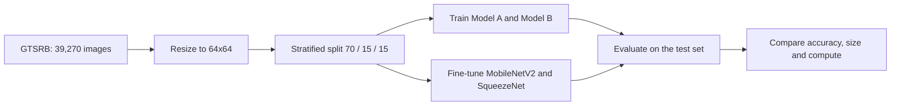

## Team

| | Member | Index no. | Responsibility | Report sections |
|---|---|---|---|---|
| <a href="https://github.com/AbishekLesley"></a> | **ABISHEK L.** ([@AbishekLesley](https://github.com/AbishekLesley)) | 230016K | Architecture design, parameter and MAC calculations, limitations | 2, 7 |
| <a href="https://github.com/Lakshan-TECH"></a> | **LUCKSHAN S.M.** ([@Lakshan-TECH](https://github.com/Lakshan-TECH)) | 230380T | Data preparation, optimizer study, repository setup | 1, 3 |
| <a href="https://github.com/sampavany"></a> | **SAMPAVI G.** ([@sampavany](https://github.com/sampavany)) | 230572J | Training and evaluation of Models A and B | 4 |
| <a href="https://github.com/Santhosh-04-S"></a> | **SANTHOSH S.** ([@Santhosh-04-S](https://github.com/Santhosh-04-S)) | 230581K | SOTA fine-tuning, final comparison and trade-offs | 5, 6 |

## Results at a glance

Test set: 5,891 images, 20 epochs per model, CPU-only training.

| Model | Parameters | fp32 size | MACs / image | CPU latency | Test accuracy | Errors |
|---|---|---|---|---|---|---|
| Model A (standard CNN) | 365,499 | 1.40 MB | 16.19 M | 1.94 ms | **99.81%** | 11 |
| **Model B (depthwise-separable)** | **66,827** | **0.28 MB** | **4.16 M** | 1.99 ms | 98.64% | 80 |
| MobileNetV2 (fine-tuned) | 2,278,955 | 8.92 MB | 24.50 M | 6.86 ms | 99.78% | 13 |
| SqueezeNet 1.1 (fine-tuned) | 744,555 | 2.86 MB | 17.17 M | 3.54 ms | 99.46% | 32 |

**Model size (fp32), one block = about 0.3 MB**

```
Model B        |█                               0.28 MB
Model A        |█████                           1.40 MB
SqueezeNet 1.1 |██████████                      2.86 MB
MobileNetV2    |██████████████████████████████  8.92 MB
```

Full tables: [results/results_tables.md](results/results_tables.md)

## Key findings

- **Accuracy vs size.** Model A (365,499 parameters) reached 99.81% test accuracy and Model B (66,827 parameters)
  reached 98.64%, which is 11 against 80 errors on 5,891 test images.
- **A small from-scratch CNN matched a pretrained network.** Model A scored 99.81%, against 99.78% for fine-tuned
  MobileNetV2, which has about 6x more parameters (2.28 M).
- **Model B is much smaller.** It has 34x fewer parameters than MobileNetV2 and about 65 KB of weights in int8
  (estimated), at a cost of 1.14 accuracy points.
- **Fewer MACs did not mean faster on a CPU.** Model B needs 3.9x fewer MACs than Model A, but single-image CPU
  latency was 1.99 ms against 1.94 ms.
- **Optimizers.** Plain SGD (lr 0.01) reached only 42.3% in 20 epochs. Momentum 0.9 reached 98.1% and momentum 0.99
  reached 99.1%, slightly above Adam (98.6%).
- **Where Model B fails.** Mostly between speed-limit signs (for example 50 vs 30 and 80), because the digits differ
  by only a few pixels at 64x64.

## Architectures

**Model A: standard CNN** (365,499 parameters)

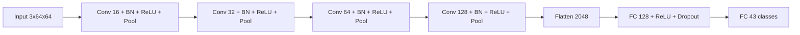

**Model B: depthwise-separable CNN** (66,827 parameters, under the 100,000 limit)

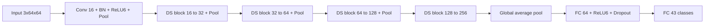

Each DS block is a depthwise 3x3 convolution followed by a pointwise 1x1 convolution, each with BatchNorm and ReLU6.

<details>
<summary><b>Parameter breakdown (click to expand)</b></summary>

| Model A layer | Parameters | Model B layer | Parameters |
|---|---|---|---|
| Conv1 3x3, 3 to 16 | 464 | Stem conv 3x3, 3 to 16 | 464 |
| Conv2 3x3, 16 to 32 | 4,672 | DS1, 16 to 32 | 752 |
| Conv3 3x3, 32 to 64 | 18,560 | DS2, 32 to 64 | 2,528 |
| Conv4 3x3, 64 to 128 | 73,984 | DS3, 64 to 128 | 9,152 |
| FC1 (2,048 to 128) | 262,272 | DS4, 128 to 256 | 34,688 |
| FC2 (128 to 43) | 5,547 | FC1 (256 to 64) | 16,448 |
| | | FC2 (64 to 43) | 2,795 |
| **Total** | **365,499** | **Total** | **66,827** |

Model A's first fully connected layer holds 72% of its parameters. Model B replaces the flatten-and-FC head with global
average pooling, so part of its saving comes from the head and not only from the separable convolutions.

</details>

**Why ReLU and ReLU6?** Both are a single comparison with no exponential, which suits microcontrollers. ReLU6 also
bounds activations to [0, 6], which makes 8-bit quantisation accurate.

## Optimizer study

Model B, 20 epochs, learning rate 0.01 for SGD and 0.001 for Adam. The effective SGD step is lr / (1 - momentum).

| Optimizer | Effective step | Epochs to 90% validation accuracy | Test accuracy |
|---|---|---|---|
| Adam (lr 0.001) | adaptive | 7 | 98.64% |
| SGD, momentum 0 | 0.01 | not reached | 42.30% |
| SGD, momentum 0.5 | 0.02 | not reached | 66.66% |
| SGD, momentum 0.9 | 0.1 | 10 | 98.13% |
| SGD, momentum 0.99 | 1.0 | 7 | **99.13%** |

Adam was kept for the main experiments because it was chosen in advance and needs no tuning. Neither learning rate
was tuned, so this compares sensible defaults and not best-case performance.

## Visual results

<p align="center">
  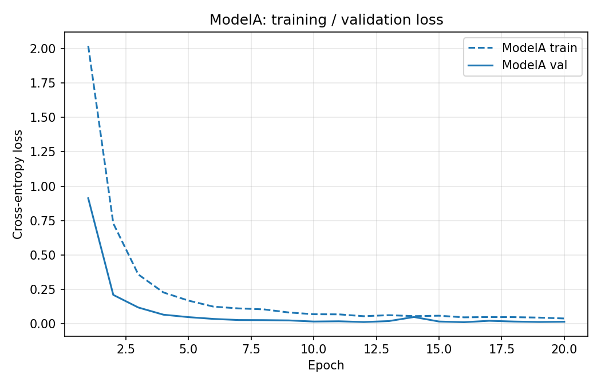
  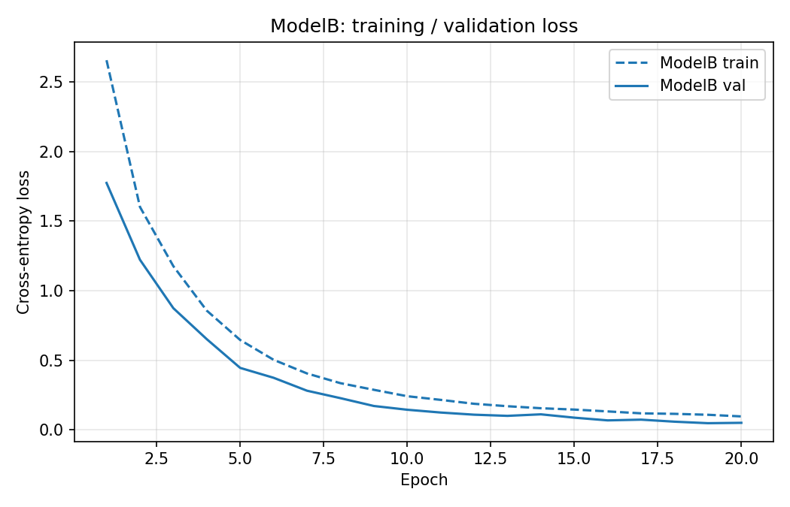
</p>
<p align="center"><i>Training and validation loss: Model A (left) and Model B (right).</i></p>

<p align="center">
  
  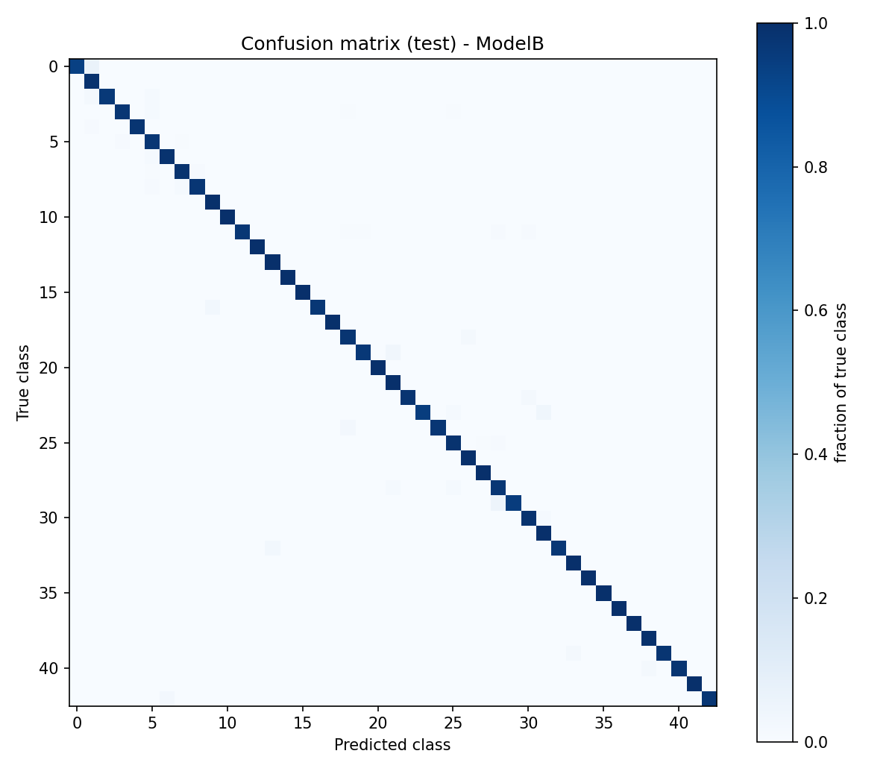
</p>
<p align="center"><i>Row-normalised confusion matrices on the test set: Model A (left) and Model B (right).</i></p>

<p align="center">
  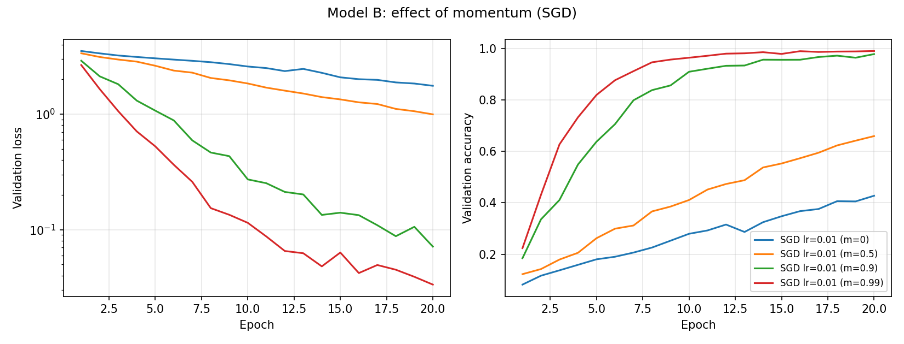
</p>
<p align="center"><i>Effect of momentum for SGD with learning rate 0.01.</i></p>

<details>
<summary><b>More figures (click to expand)</b></summary>

<p align="center">
  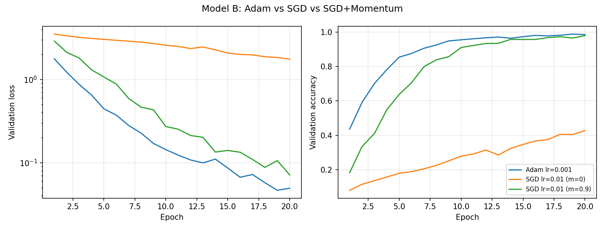
  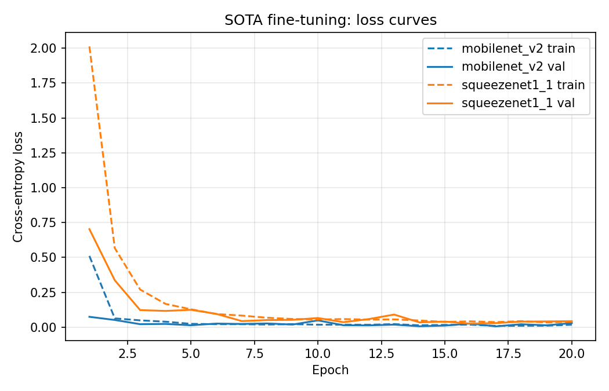
  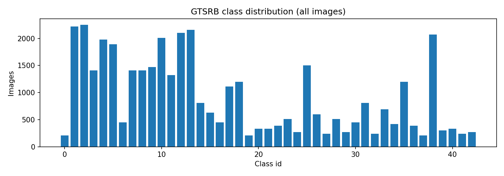
  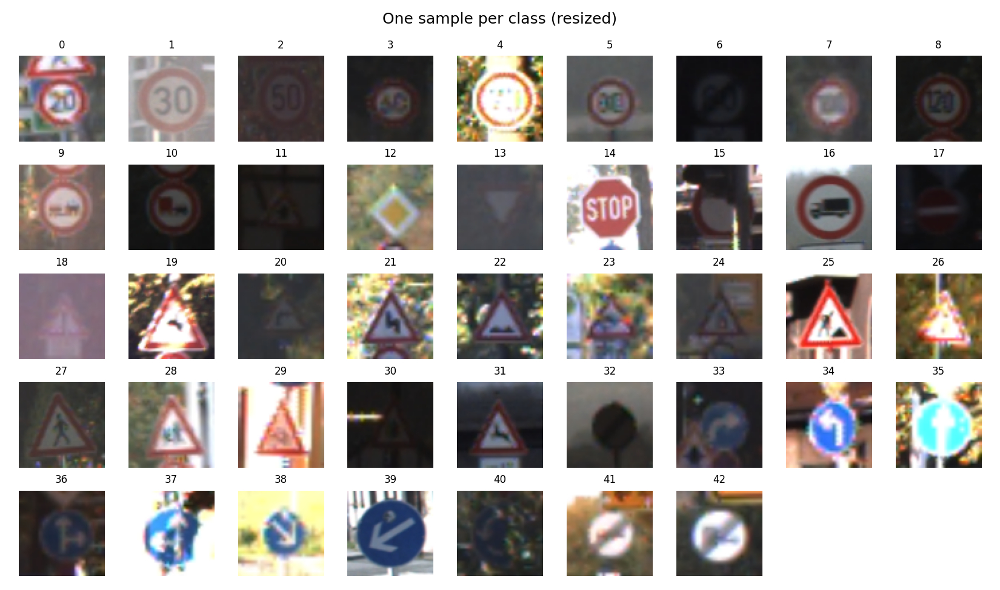
</p>

</details>

## Repository structure

```
.
├── gtsrb_edge_cnn.py        training and evaluation script (all tasks)
├── requirements.txt         Python dependencies
├── README.md
├── docs/
│   ├── Overfitting_A03_EN3150.pdf        full report
│   ├── banner.svg                        animated banner
│   ├── data_and_optimizer_notes.md
│   ├── architecture_notes.md
│   ├── training_evaluation_notes.md
│   ├── sota_comparison_notes.md
│   └── GIT_GUIDE.md
└── results/
    ├── results_tables.md
    ├── per_class_ModelB.csv
    └── figures/             all plots used in the report
```

## How to run

<details open>
<summary><b>Quick start</b></summary>

```bash
pip install -r requirements.txt

# full run: downloads GTSRB, trains all models (about 1.5 hours on a CPU)
python gtsrb_edge_cnn.py

# quick smoke test with random data, no download
python gtsrb_edge_cnn.py --epochs 2 --fake-data --skip-sota
```

Outputs (figures, confusion matrices, per-class CSV files, `results.json`) are written to `./outputs`, which is not
tracked by git.

</details>

<details>
<summary><b>Useful options</b></summary>

| Option | Meaning |
|---|---|
| `--epochs N` | number of epochs (default 20) |
| `--batch N` | batch size (default 128) |
| `--lr X` | Adam learning rate for the custom models (default 0.001) |
| `--skip-opt` | skip the optimizer comparison |
| `--skip-sota` | skip fine-tuning MobileNetV2 and SqueezeNet |
| `--no-augment` | disable training augmentation |
| `--seed N` | random seed (default 42) |

</details>

## Limitations

- One training run per model (seed 42), so differences of a few tenths of a percent may be noise.
- All timings were measured on a CPU, so they are only a proxy for a microcontroller.
- int8 sizes are estimates (one byte per parameter), not measured after real quantisation.
- GTSRB images come in sequences of about 30 frames of the same physical sign. A random split can place
  near-identical frames in both training and test sets, so the accuracies may be slightly optimistic.
- The pretrained networks were used at 64x64 instead of the 224x224 they expect.

## Documentation

- Full report: [docs/Overfitting_A03_EN3150.pdf](docs/Overfitting_A03_EN3150.pdf)
- Data and optimizer notes: [docs/data_and_optimizer_notes.md](docs/data_and_optimizer_notes.md)
- Architecture notes: [docs/architecture_notes.md](docs/architecture_notes.md)
- Training and evaluation notes: [docs/training_evaluation_notes.md](docs/training_evaluation_notes.md)
- SOTA comparison notes: [docs/sota_comparison_notes.md](docs/sota_comparison_notes.md)

## References

1. J. Stallkamp, M. Schlipsing, J. Salmen and C. Igel, "Man vs. computer: Benchmarking machine learning algorithms for traffic sign recognition", *Neural Networks*, 2012.
2. M. Sandler et al., "MobileNetV2: Inverted residuals and linear bottlenecks", *CVPR*, 2018.
3. F. N. Iandola et al., "SqueezeNet: AlexNet-level accuracy with 50x fewer parameters and <0.5MB model size", arXiv:1602.07360, 2016.
4. A. G. Howard et al., "MobileNets: Efficient convolutional neural networks for mobile vision applications", arXiv:1704.04861, 2017.
5. D. P. Kingma and J. Ba, "Adam: A method for stochastic optimization", *ICLR*, 2015.

---

<p align="center"><sub>Built by group <b>Overfitting</b> for EN3150, University of Moratuwa.</sub></p>
